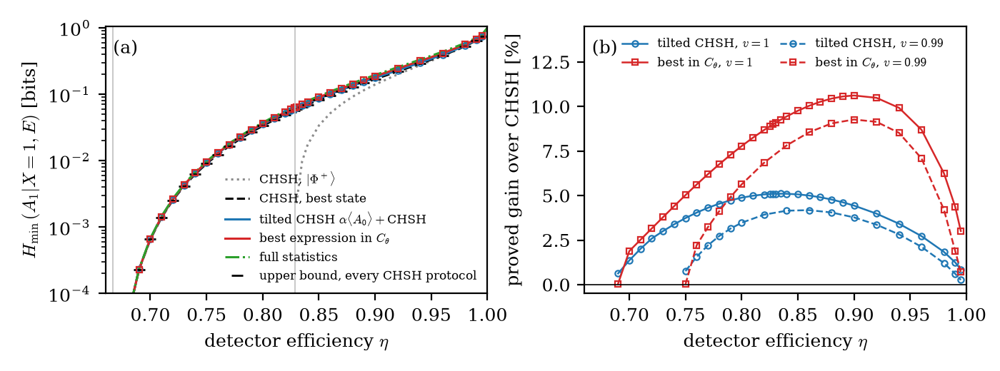
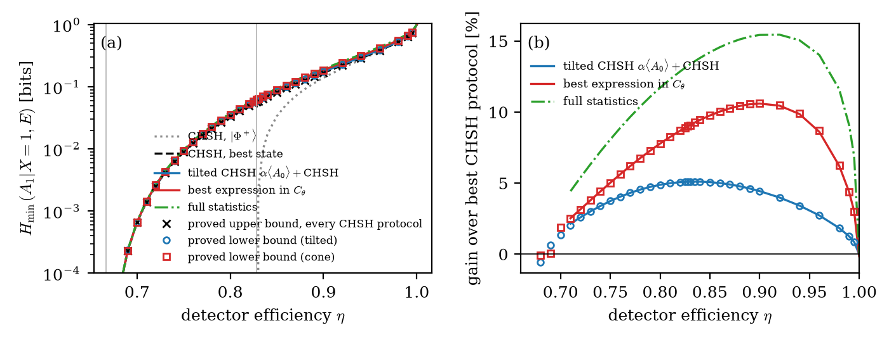
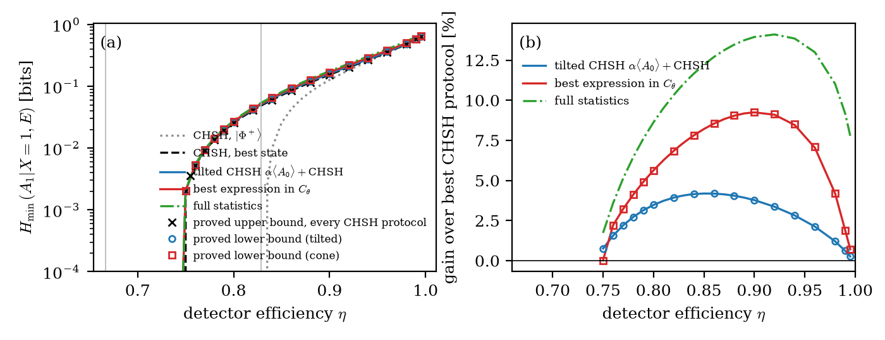
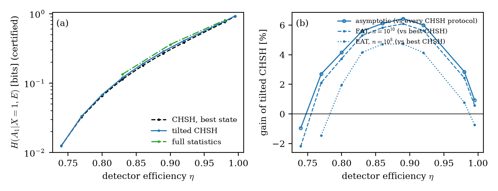
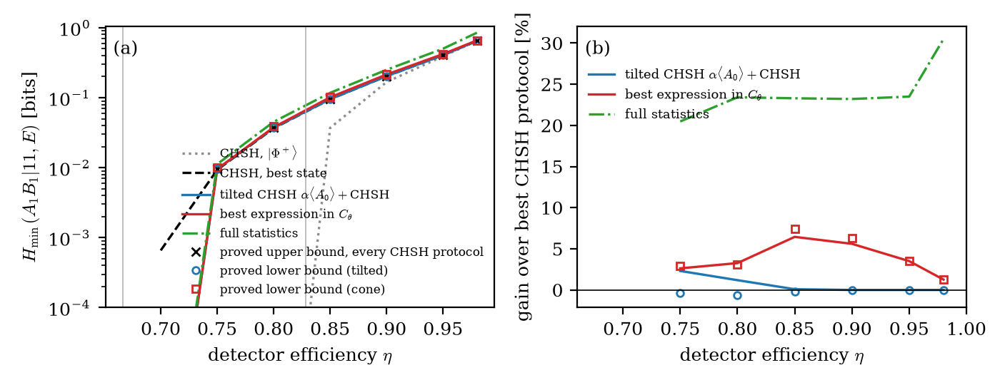

# Detection efficiency: certified randomness of tilted-CHSH and normal-cone witnesses vs. every CHSH protocol

Ravishankar Ramanathan (HKU). Study run on 22 Oct 2026; all files are in `/workspace/ndwu/eta_study/`.

## 1. Question and answer in plain language

**The question.** Real detectors miss photons. We model symmetric detectors of efficiency η, with a missed detection recorded as outcome +1, plus optional white noise (v = 1 and v = 0.99). Is there a range of η where a tilted-CHSH Bell expression (α⟨A₀⟩ + CHSH), or the best expression in the normal-cone polygon C_θ of a tilted target (Thm 2), certifies more randomness than **any** protocol that records only the CHSH value? Here "any" means any state, any measurements, any dimension, with CHSH maximally entangled or optimally tilted for loss. We also compare against the full statistics.

**The answer: yes, at every efficiency we examined, and it is proved.**

- **v = 1 (pure loss), one-sided min-entropy H_min(A₁|X=1,E).** At each of the 31 grid efficiencies η = 0.69, 0.70, …, 0.995, we prove two things:
  - α⟨A₀⟩+CHSH certifies more than the best possible CHSH protocol, by +0.6% to +5.1% (largest around η ≈ 0.82–0.85).
  - The best expression in C_θ′ certifies more again, by up to +10.6% (around η ≈ 0.89–0.90; for example 0.186 vs. at most 0.168 bits at η = 0.90).
  - Full statistics (numerical only) reaches about +15%.
- **Against maximally entangled CHSH the gain is unbounded below η = 2/(1+√2) ≈ 0.828.** That protocol certifies exactly zero there. The tilted witnesses keep working down to the Eberhard threshold 2/3, and so does optimally tilted CHSH.
- **v = 0.99.** At each of the 17 grid efficiencies η = 0.75, 0.76, …, 0.995, both witnesses are proved better than every CHSH protocol: tilted by +0.3% to +4.2%, C_θ′ by +0.02% to +9.3%. Here CHSH needs η ≳ 0.745.
- **Von Neumann entropy H(A₁|X=1,E), v = 1.** This entropy sets asymptotic and finite-size rates. α⟨A₀⟩+CHSH, with its own device and α, beats the tight CHSH bound at η = 0.77–0.995 (8 points), by +0.9% (η = 0.995) up to +6.4% (η = 0.89); at η = 0.74 the gain is only numerical (the certified value falls just short).
- **Finite size (EAT).** At n = 10¹⁰ rounds, the tilted protocol gives the larger EAT rate wherever its asymptotic gain holds (η = 0.77–0.995). At n = 10⁸ it is larger for 0.80 ≤ η ≤ 0.98, but slightly smaller at η = 0.995 and η = 0.77. The steeper min-tradeoff function costs more in the second-order term.
- **Two-party randomness H_min(A₁B₁|11,E).** The tilted family gives **no** gain: the optimal α → 0, so it reduces to CHSH. The best expression in C_θ′ is proved better than every CHSH protocol at η = 0.75, 0.80, 0.85, 0.90, 0.95 and 0.98, by +1.3% to +7.4%. Full statistics is much larger (numerical).

**What this means physically.** Loss makes the observed behaviour look like a partially entangled, biased one. The data then sit near the target of a tilted expression rather than near the CHSH point. A single number adapted to that target (one marginal term for tilted CHSH, or the best vertex combination of the normal-cone polygon) therefore sees more of the data than CHSH does. The gain is modest, not a multiplicative factor. It vanishes as η → 1 (where CHSH is already optimal) and as η → 2/3 (where everything vanishes). It survives 1% white noise. Most of what the full statistics certifies beyond CHSH is captured by one well-chosen expression from C_θ′: about 70% of the full-statistics gain at v = 1, η = 0.90.

## 2. Model and method

- **Loss model.** Each party's detector clicks with probability η; a no-click is output as +1. On correlators:
  - a′ = ηa + (1−η) and b′ = ηb + (1−η);
  - E′_xy = η²E_xy + η(1−η)(a_x + b_y) + (1−η)².
  - Noise acts first: the ideal behaviour z is replaced by v·z.
  - The map is affine. A Bell functional g on lossy data is therefore a functional g_η on ideal data plus a constant: g·z_η = c₀ + g_η·z (`core.loss_functional`, exact rationals in `cert_eta.loss_functional_F`).
- **CHSH protocols.**
  - With the maximally entangled state: S = 2√2η² + 2(1−η)², which exceeds 2 only for η > 0.8284.
  - With the state and measurements optimised for loss (Eberhard): S > 2 down to η = 2/3.
  - Certified rates are the tight closed forms H_min(S) = −log₂(½ + ½√(2 − S²/4)) (Pironio et al. 2010) and H(A|E) ≥ 1 − h(½ + ½√(S²/4 − 1)) (Pironio et al. 2009). Both are tight, attained by explicit qubit attacks, and increasing in S. So **the best CHSH protocol is the one with the largest S at efficiency η**, and an upper bound on S at efficiency η bounds every CHSH protocol.
- **Upper bound for every CHSH protocol (rigorous).** S ≤ S_up(η) = c₀ + v·β, where β is an exact-rational NPA certificate (level 3) of the quantum maximum of g_η, valid in any dimension, and β ≥ 0 is asserted. H_min(S_up) is then evaluated in interval arithmetic and matched by an explicit qubit attack (`rigorous_rates`).
  - Other sign variants of CHSH, and other deterministic no-click binnings, are no better: we certified this at η = 0.70, 0.75, 0.80, 0.85, 0.90, 0.95 (`variants_check.py`; all agree with the canonical +++− with +1 binning to 10⁻¹⁰).
- **Tilted and normal-cone witnesses (lower bounds, rigorous).**
  - The honest device is a qubit pair: state cos θ|00⟩ + sin θ|11⟩ with four measurement angles, all rounded to dyadic rationals, and the efficiency η applied.
  - Its expected score ω for the witness g is computed in arb (interval arithmetic).
  - The certified guessing probability is bounded by Lemma 1: P_g ≤ max_e h_Q(Π_e + μg) − μω, with exact-rational NPA dual certificates for each h_Q (level 1+AB, or 2). This gives a rigorous lower bound on H_min for the protocol that records g alone.
  - Families:
    - (a) tilted: α⟨A₀⟩ + CHSH, with α and the device optimised;
    - (b) cone: the best expression in the polygon C_θ′ of the tilted target θ′ (vertices from Thm 2; reproduces the hexagon at π/8 and BB's octagon at π/4), with θ′, the convex weights and the device optimised;
    - (c) full statistics: numerical NPA level 1+AB only, as an upper reference.
  - For H_min, the full-statistics bound equals the best single Bell expression (Nieto-Silleras, Pironio & Silman 2014; Bancal, Sheridan & Scarani 2014). So (c) is the ceiling for any one-expression protocol.
- **What "proved" means.** At a given (η, v): (certified lower bound for the witness protocol, from exact rational certificates plus interval arithmetic) > (certified upper bound for every CHSH protocol). Both sides are independently re-checked by `verify_eta.py`, which uses only exact rationals, flint/arb and numpy, and no SDP solver. Interval widths are about 10⁻⁸.
- **Von Neumann entropy.**
  - Brown–Fawzi–Fawzi (BFF) Gauss–Radau hierarchy (m = 8, NPA level 2 + extra monomials).
  - The dual solution is rounded to rationals and its positive-semidefiniteness checked **exactly** (rational LDL, `bffexact.py`). This gives an affine min-tradeoff function H ≥ K₀ + κ·z valid for all quantum z.
  - Device and α are optimised for vN separately from H_min (`vn_opt.py`): the H_min-optimal devices are poor for vN.
- **Finite size.** EAT in the form of Liu et al. (Nat. Phys. 2021, App. A, Thm 3) with spot-checking (`../rates_v11/eat.py`):
  - ε_EAT = 3.09×10⁻¹², ε_h = 1.545×10⁻¹², completeness 10⁻⁶;
  - the test probability γ and Rényi order α_R are optimised.
  - CHSH uses the tangent of the tight curve at the best device.

## 3. What is proved and what is numerical

| statement | v = 1 | v = 0.99 | status |
|---|---|---|---|
| α⟨A₀⟩+CHSH certifies more H_min(A₁\|E) than every CHSH protocol | every grid η in [0.69, 0.995] (31 points) | every grid η in [0.75, 0.995] (17 points) | **proved** (exact certificates, `verify_eta.py`) |
| best expression in C_θ′ certifies more H_min(A₁\|E) than every CHSH protocol | every grid η in [0.69, 0.995] (31 points) | every grid η in [0.75, 0.995] (17 points) | **proved** |
| same, two-party H_min(A₁B₁\|E), C_θ′ | η = 0.75, 0.80, 0.85, 0.90, 0.95, 0.98 | not run | **proved** |
| α⟨A₀⟩+CHSH, two-party | no gain (α → 0) | not run | numerical; nothing claimed |
| maximally entangled CHSH certifies 0 for η ≤ 2/(1+√2) | analytic | analytic (threshold ≈ 0.833) | exact |
| α⟨A₀⟩+CHSH certifies more vN entropy H(A₁\|E) than every CHSH protocol | η = 0.995, 0.98, 0.92, 0.89, 0.86, 0.83, 0.80, 0.77 | see Table 4 | **certified** (exact-PSD BFF; quadrature nodes in double precision, see caveats) |
| same at η = 0.74 | not certified: certified 0.01241 vs ≤ 0.01253 for CHSH (numerical BFF value 0.01298 does exceed it) | – | numerical only |
| gains between grid points; η < 0.69 (v = 1) or η < 0.75 (v = 0.99) | – | – | **numerical only** (curves in the figures) |
| η = 0.68, v = 1 | margins (≈10⁻⁷) below the certificate precision | – | not proved |
| full statistics | all η | all η | numerical NPA estimates only (an upper reference) |
| EAT finite-size rates | tables 3–4 | tables 3–4 | rigorous **lower** bounds for each protocol; they compare achievable rates, they are not a separation theorem |

The claims are **pointwise on the grid**. We do not claim a continuum statement between grid points. The gaps are smooth in η and at least 10³ times the interval widths for 0.70 ≤ η ≤ 0.99, but an interval statement would need a separate (Lipschitz) argument, which we have not made.

## 4. Tables

Column notes:
- "every CHSH protocol ≤" is the certified upper bound H(S_up(η)), valid for any CHSH protocol, any state, any measurements and any dimension.
- Bracketed entries are two-sided intervals wider than 5×10⁻⁷.
- Gains are relative to that upper bound.
- θ′ is the target of the best expression found in C_θ′.
- The full-statistics columns are numerical (NPA 1+AB).
- n/a† marks an ill-conditioned full-statistics dual (|κ| ~ 10³), for which the EAT second-order term dominates.

### Table 1: H_min(A1|X=1,E), v = 1

| η | S_max(η) ≤ | CHSH, \|Φ+⟩ | **every CHSH protocol ≤** | tilted α⟨A₀⟩+CHSH (proved) | best in C_θ′ (proved) | θ′/π | full stats (numerical) | gain tilted | gain cone | separation |
|---|---|---|---|---|---|---|---|---|---|---|
| 0.995 | 2.800384 | 0.738078 | 0.738589 | 0.744898 | 0.760816 | 0.2047 | 0.789236 | +0.9% | +3.0% | **proved** (tilted, cone) |
| 0.990 | 2.772824 | 0.643593 | 0.644943 | 0.652985 | 0.673147 | 0.2072 | 0.703334 | +1.2% | +4.4% | **proved** (tilted, cone) |
| 0.980 | 2.719153 | 0.522163 | 0.525646 | 0.535303 | 0.558502 | 0.2101 | 0.586605 | +1.8% | +6.3% | **proved** (tilted, cone) |
| 0.960 | 2.617612 | 0.372300 | 0.381057 | 0.391438 | 0.414197 | 0.2202 | 0.434464 | +2.7% | +8.7% | **proved** (tilted, cone) |
| 0.940 | 2.523821 | 0.272858 | 0.287693 | 0.297530 | [0.316249, 0.316251] | 0.2280 | 0.331009 | +3.4% | +9.9% | **proved** (tilted, cone) |
| 0.920 | 2.437813 | 0.198537 | 0.220005 | 0.228772 | 0.243076 | 0.2333 | 0.253986 | +4.0% | +10.5% | **proved** (tilted, cone) |
| 0.900 | 2.359631 | 0.139755 | 0.168312 | 0.175780 | 0.186183 | 0.2372 | 0.194278 | +4.4% | +10.6% | **proved** (tilted, cone) |
| 0.890 | 2.323491 | 0.114590 | 0.146850 | 0.153636 | 0.162363 | 0.2388 | 0.169323 | +4.6% | +10.6% | **proved** (tilted, cone) |
| 0.880 | 2.289328 | 0.091689 | 0.127756 | 0.133859 | 0.141099 | 0.2402 | 0.147065 | +4.8% | +10.4% | **proved** (tilted, cone) |
| 0.870 | 2.257149 | 0.070747 | 0.110726 | 0.116156 | 0.122094 | 0.2415 | 0.127186 | +4.9% | +10.3% | **proved** (tilted, cone) |
| 0.860 | 2.226958 | 0.051520 | 0.095517 | 0.100294 | 0.105104 | 0.2426 | 0.109426 | +5.0% | +10.0% | **proved** (tilted, cone) |
| 0.850 | 2.198761 | 0.033807 | 0.081930 | 0.086082 | 0.089927 | 0.2436 | 0.093570 | +5.1% | +9.8% | **proved** (tilted, cone) |
| 0.840 | 2.172559 | 0.017441 | 0.069803 | 0.073363 | 0.076393 | 0.2445 | 0.079437 | +5.1% | +9.4% | **proved** (tilted, cone) |
| 0.835 | 2.160207 | 0.009719 | 0.064243 | 0.067522 | 0.070195 | 0.2449 | 0.072968 | +5.1% | +9.3% | **proved** (tilted, cone) |
| 0.830 | 2.148354 | 0.002282 | 0.058998 | 0.062007 | 0.064355 | 0.2453 | 0.066874 | +5.1% | +9.1% | **proved** (tilted, cone) |
| 0.828 | 2.143752 | 0 | 0.056986 | 0.059889 | 0.062116 | 0.2454 | 0.064538 | +5.1% | +9.0% | **proved** (tilted, cone) |
| 0.825 | 2.136998 | 0 | 0.054055 | 0.056805 | 0.058858 | 0.2456 | 0.061139 | +5.1% | +8.9% | **proved** (tilted, cone) |
| 0.820 | 2.126139 | 0 | 0.049401 | 0.051902 | 0.053690 | 0.2460 | 0.055749 | +5.1% | +8.7% | **proved** (tilted, cone) |
| 0.810 | 2.105907 | 0 | 0.040911 | 0.042953 | 0.044286 | 0.2466 | 0.045945 | +5.0% | +8.2% | **proved** (tilted, cone) |
| 0.800 | 2.087640 | 0 | 0.033444 | 0.035077 | 0.036046 | 0.2472 | 0.037361 | +4.9% | +7.8% | **proved** (tilted, cone) |
| 0.790 | 2.071316 | 0 | 0.026923 | 0.028197 | 0.028884 | 0.2477 | 0.029904 | +4.7% | +7.3% | **proved** (tilted, cone) |
| 0.780 | 2.056901 | 0 | 0.021280 | 0.022247 | 0.022717 | 0.2481 | 0.023491 | +4.5% | +6.8% | **proved** (tilted, cone) |
| 0.770 | 2.044351 | 0 | 0.016453 | 0.017162 | 0.017473 | 0.2485 | 0.018042 | +4.3% | +6.2% | **proved** (tilted, cone) |
| 0.760 | 2.033609 | 0 | 0.012382 | 0.012883 | 0.013079 | 0.2488 | 0.013483 | +4.0% | +5.6% | **proved** (tilted, cone) |
| 0.750 | 2.024604 | 0 | 0.009013 | 0.009349 | 0.009465 | 0.2491 | 0.009740 | +3.7% | +5.0% | **proved** (tilted, cone) |
| 0.740 | 2.017245 | 0 | 0.006288 | 0.006501 | 0.006565 | 0.2493 | 0.006741 | +3.4% | +4.4% | **proved** (tilted, cone) |
| 0.730 | 2.011427 | 0 | 0.004151 | 0.004276 | 0.004308 | 0.2495 | 0.004413 | +3.0% | +3.8% | **proved** (tilted, cone) |
| 0.720 | 2.007019 | 0 | 0.002543 | 0.002609 | 0.002623 | 0.2496 | 0.002680 | +2.6% | +3.2% | **proved** (tilted, cone) |
| 0.710 | 2.003874 | 0 | 0.001400 | [0.001429, 0.001430] | 0.001436 | 0.2498 | 0.001462 | +2.0% | +2.5% | **proved** (tilted, cone) |
| 0.700 | 2.001814 | 0 | 0.000655 | [0.000664, 0.000666] | 0.000667 | 0.2499 | 0.000678 | +1.4% | +1.9% | **proved** (tilted, cone) |
| 0.690 | 2.000641 | 0 | 0.000231 | [0.000233, 0.000234] | 0.000231 | 0.2500 | 0.000237 | +0.6% | +0.0% | **proved** (tilted, cone) |
| 0.680 | 2.000123 | 0 | 0.000044 | [0.000044, 0.000045] | 0.000044 | 0.2500 | 0.000045 | -0.5% | -0.1% | not proved |

### Table 2: H_min(A1|X=1,E), v = 0.99

| η | S_max(η) ≤ | CHSH, \|Φ+⟩ | **every CHSH protocol ≤** | tilted α⟨A₀⟩+CHSH (proved) | best in C_θ′ (proved) | θ′/π | full stats (numerical) | gain tilted | gain cone | separation |
|---|---|---|---|---|---|---|---|---|---|---|
| 0.995 | 2.772381 | 0.643370 | 0.643703 | 0.645420 | 0.648250 | 0.2313 | 0.693822 | +0.3% | +0.7% | **proved** (tilted, cone) |
| 0.990 | 2.745098 | 0.575928 | 0.576962 | 0.580490 | 0.587896 | 0.2206 | 0.629841 | +0.6% | +1.9% | **proved** (tilted, cone) |
| 0.980 | 2.691970 | 0.477021 | 0.479991 | 0.485791 | 0.500169 | 0.2194 | 0.532905 | +1.2% | +4.2% | **proved** (tilted, cone) |
| 0.960 | 2.591468 | 0.344366 | 0.352332 | 0.359814 | 0.377314 | 0.2263 | 0.398101 | +2.1% | +7.1% | **proved** (tilted, cone) |
| 0.940 | 2.498655 | 0.252642 | 0.266466 | 0.273980 | 0.289169 | 0.2318 | 0.303365 | +2.8% | +8.5% | **proved** (tilted, cone) |
| 0.920 | 2.413563 | 0.182854 | 0.203115 | 0.209949 | 0.221677 | 0.2362 | 0.231757 | +3.4% | +9.1% | **proved** (tilted, cone) |
| 0.900 | 2.336235 | 0.127098 | 0.154262 | 0.160085 | 0.168561 | 0.2395 | 0.175775 | +3.8% | +9.3% | **proved** (tilted, cone) |
| 0.880 | 2.266723 | 0.081209 | 0.115701 | 0.120388 | 0.126172 | 0.2422 | 0.131283 | +4.1% | +9.1% | **proved** (tilted, cone) |
| 0.860 | 2.205080 | 0.042687 | 0.084925 | 0.088477 | 0.092190 | 0.2443 | 0.095715 | +4.2% | +8.6% | **proved** (tilted, cone) |
| 0.840 | 2.151346 | 0.009898 | 0.060314 | 0.062817 | 0.065027 | 0.2460 | 0.067348 | +4.2% | +7.8% | **proved** (tilted, cone) |
| 0.820 | 2.105526 | 0 | 0.040754 | 0.042355 | 0.043543 | 0.2474 | 0.044960 | +3.9% | +6.8% | **proved** (tilted, cone) |
| 0.800 | 2.067563 | 0 | 0.025444 | 0.026328 | 0.026876 | 0.2484 | 0.027638 | +3.5% | +5.6% | **proved** (tilted, cone) |
| 0.790 | 2.051484 | 0 | 0.019187 | 0.019790 | 0.020130 | 0.2489 | 0.020648 | +3.1% | +4.9% | **proved** (tilted, cone) |
| 0.780 | 2.037300 | 0 | 0.013774 | 0.014150 | 0.014342 | 0.2492 | 0.014664 | +2.7% | +4.1% | **proved** (tilted, cone) |
| 0.770 | 2.024966 | 0 | 0.009147 | 0.009349 | 0.009443 | 0.2496 | 0.009617 | +2.2% | +3.2% | **proved** (tilted, cone) |
| 0.760 | 2.014425 | 0 | 0.005250 | 0.005332 | 0.005367 | 0.2498 | 0.005439 | +1.6% | +2.2% | **proved** (tilted, cone) |
| 0.750 | 2.005608 | 0 | 0.002030 | 0.002045 | 0.002030 | 0.2500 | 0.002065 | +0.8% | +0.0% | **proved** (tilted, cone) |

### Table 3: von Neumann H(A1|X=1,E) and EAT rates, v = 1

| η | CHSH, best device | **every CHSH protocol ≤** | tilted (BFF, exact-PSD cert.) | α | full stats (BFF cert.) | separation | EAT n=1e8: CHSH / tilted / full | EAT n=1e10: CHSH / tilted / full |
|---|---|---|---|---|---|---|---|---|
| 0.995 | 0.919440 | 0.919440 | 0.927990 | 0.355 | – | **proved** | 0.7960 / 0.7901 / – | 0.8926 / 0.8978 / – |
| 0.980 | 0.760264 | 0.760265 | 0.781917 | 0.311 | 0.810283 | **proved** | 0.6660 / 0.6711 / n/a† | 0.7400 / 0.7579 / n/a† |
| 0.920 | 0.386351 | 0.386351 | 0.409554 | 0.159 | – | **proved** | 0.3293 / 0.3429 / – | 0.3742 / 0.3953 / – |
| 0.890 | 0.269471 | 0.269471 | 0.286807 | 0.106 | – | **proved** | 0.2223 / 0.2328 / – | 0.2595 / 0.2753 / – |
| 0.860 | 0.180684 | 0.180684 | 0.191720 | 0.061 | – | **proved** | 0.1414 / 0.1481 / – | 0.1724 / 0.1825 / – |
| 0.830 | 0.114021 | 0.114021 | 0.120398 | 0.039 | – | **proved** | 0.0816 / 0.0849 / – | 0.1072 / 0.1129 / – |
| 0.800 | 0.065605 | 0.065605 | 0.068326 | 0.024 | – | **proved** | 0.0393 / 0.0401 / – | 0.0601 / 0.0623 / – |
| 0.770 | 0.032593 | 0.032594 | 0.033472 | 0.014 | – | **proved** | 0.0122 / 0.0120 / – | 0.0283 / 0.0289 / – |
| 0.740 | 0.012530 | 0.012530 | 0.012410 | 0.007 | – | not proved | n/a† / n/a† / – | 0.0094 / 0.0092 / – |

### Table 4: von Neumann, v = 0.99

| η | CHSH, best device | **every CHSH protocol ≤** | tilted (BFF, exact-PSD cert.) | α | full stats (BFF cert.) | separation | EAT n=1e8: CHSH / tilted / full | EAT n=1e10: CHSH / tilted / full |
|---|---|---|---|---|---|---|---|---|
| 0.940 | 0.454863 | 0.454863 | – | – | – | – | 0.3919 / – / – | 0.4414 / – / – |

### Table 5: two-party H_min(A1B1|X=1,Y=1,E), v = 1

| η | S_max(η) ≤ | CHSH, \|Φ+⟩ | **every CHSH protocol ≤** | tilted α⟨A₀⟩+CHSH (proved) | best in C_θ′ (proved) | θ′/π | full stats (numerical) | gain tilted | gain cone | separation |
|---|---|---|---|---|---|---|---|---|---|---|
| 0.980 | 2.719153 | 0.646028 | 0.650348 | 0.650348 | 0.658519 | 0.2482 | 0.848694 | -0.0% | +1.3% | **proved** (cone) |
| 0.950 | 2.569746 | 0.391762 | 0.406460 | 0.406460 | 0.420869 | 0.2448 | 0.501984 | -0.0% | +3.5% | **proved** (cone) |
| 0.900 | 2.359631 | 0.167530 | 0.203270 | 0.203270 | 0.216059 | 0.2446 | 0.250447 | -0.0% | +6.3% | **proved** (cone) |
| 0.850 | 2.198761 | 0.037038 | 0.096029 | 0.095806 | 0.103148 | 0.2464 | 0.117381 | -0.2% | +7.4% | **proved** (cone) |
| 0.800 | 2.087640 | 0.000000 | 0.037648 | 0.037425 | 0.038811 | 0.2500 | 0.045192 | -0.6% | +3.1% | **proved** (cone) |
| 0.750 | 2.024604 | 0.000000 | 0.009663 | 0.009630 | 0.009947 | 0.2500 | 0.011216 | -0.3% | +2.9% | **proved** (cone) |

### Figures

*Proposed PRL figure (`figs/fig_eta_prl.pdf`).* (a) H_min(A₁|X=1,E) vs η at v = 1. Lines show numerical optima; bars are proved upper bounds for every CHSH protocol; circles and squares are proved lower bounds for the tilted and C_θ′ witnesses. (b) Proved gain over every CHSH protocol at v = 1 and v = 0.99.

## 5. Von Neumann entropy and finite size

- **Asymptotic (Table 3).** For the vN entropy, the tilted protocol, with its own device and α (α = 0.36 at η = 0.995, falling to 0.014 at η = 0.77), beats the tight vN bound of every CHSH protocol by:
  - +0.9% at η = 0.995;
  - +2.8% at 0.98;
  - +6.0% at 0.92;
  - +6.4% at 0.89;
  - +6.1% at 0.86;
  - +5.6% at 0.83;
  - +4.2% at 0.80;
  - +2.7% at 0.77.

  At η = 0.74 the numerical BFF value (0.01298) exceeds the CHSH bound (0.01253), but the rounded, certified value (0.01241) does not, so nothing is claimed there. The relative vN gain is larger than the H_min gain of the same family at the same η.
- **Devices matter.** At the H_min-optimal devices, the vN entropy of the cone and full-statistics protocols came out *below* CHSH (e.g. full statistics 0.916 vs CHSH 0.919 at η = 0.995). A vN comparison must therefore re-optimise the device, as done here.
- **EAT (Table 3).**
  - At n = 10¹⁰ the tilted protocol has the higher EAT rate at every η where its asymptotic vN gain holds (0.77–0.995), e.g. 0.3953 vs 0.3742 bits per round at η = 0.92 (+5.6%).
  - At n = 10⁸ it is higher for 0.80 ≤ η ≤ 0.98, e.g. 0.3429 vs 0.3293 at η = 0.92. It is *lower* at η = 0.995 (0.7901 vs 0.7960) and at η = 0.77 (0.0120 vs 0.0122): the larger gradient of the tilted min-tradeoff function costs more in the second-order term.
  - These are lower bounds on achievable rates, protocol by protocol. They are not upper bounds on CHSH, so they show what each protocol certifies; they are not a separation theorem.
- **Full statistics, vN.** The BFF certificate at η = 0.98 gives 0.810, against 0.760 for CHSH. Its min-tradeoff function has |κ| ≈ 10³ (an ill-conditioned dual), and the EAT second-order term then makes the finite-size rate vanish (marked n/a† in the tables). A regularised dual would be needed for a finite-size full-statistics rate. We did not pursue this; it is a reference only.

## 6. Two-party randomness

For the pair (A₁,B₁), adding ⟨A₀⟩ does not help: the optimal α → 0, and the certified value equals or falls slightly below the CHSH bound (Table 5). The best expression in C_θ′ does help, and is proved better than every CHSH protocol at η = 0.75–0.98 (+1.3% to +7.4%). Full statistics certifies much more (numerical, e.g. 0.849 vs 0.650 bits at η = 0.98), so for two-party randomness a single expression from this polygon leaves most of the full-statistics gain on the table. These devices were optimised for the two-party guess but not refined, so the C_θ′ values are lower bounds on what that family can do.

## 7. Caveats

1. Every separation is proved at grid points, not on a continuum of η (Section 3).
2. Model: symmetric efficiency, no-click binned to +1, independent losses, white noise applied before loss. Asymmetric efficiencies, dark counts and multi-photon events are not modelled.
3. The tilted and cone *lower* bounds use one explicit qubit device per point (numerically optimised, then fixed with dyadic angles). Better devices could only increase them. The CHSH *upper* bound covers all devices in all dimensions.
4. "Every CHSH protocol" means every protocol that certifies from the CHSH value alone, of the canonical form with +1 binning. Other sign variants and binnings were certified to be no better at η = 0.70–0.95 (6 points), not at every grid point.
5. vN: the BFF dual is certified PSD in exact arithmetic, but the Gauss–Radau nodes and weights are double-precision numbers. This is a floating-point caveat on the order of 10⁻¹⁵, compared with gaps of 10⁻³ to 10⁻². The vN statements are therefore labelled "certified", not "proved" in the strict sense of the H_min chain.
6. EAT numbers are lower bounds per protocol (Liu et al. 2021 form, conservative variance). They are not a finite-size separation theorem.
7. Full statistics is numerical throughout; it is shown only as a ceiling.
8. Bug fixed during the study: an early version of the CHSH upper bound ignored the visibility v. All v = 0.99 results were recomputed and re-verified after the fix (`STATUS.md`, 10:16–10:36 HKT).

## 8. Files

- `REPORT.md`: this report (tables auto-generated in `out/tables.md` by `make_tables.py`).
- `figs/fig_eta_prl.pdf/.png`: the proposed PRL figure. (a) H_min vs η at v = 1, with curves for all families and markers for the proved bounds. (b) Proved gain over every CHSH protocol, at v = 1 and v = 0.99.
- `figs/fig_eta_hmin_v1`, `figs/fig_eta_hmin_v099`, `figs/fig_eta_hmin_AB_v1`: H_min and gain over CHSH, including full statistics.
- `figs/fig_eta_vn_v1`: vN entropy and EAT rates.
- `prl_paragraph_eta.tex`: proposed PRL paragraph, figure environment and new bib items. The PRL source files themselves are untouched.
- `verify_eta.py`: standalone verifier, run as `python3 verify_eta.py`. It re-checks every certificate in `certs/` in exact arithmetic and arb, with no SDP solver, in about 2 s. Output: `out/verify_eta.log`, `out/verified_eta.json`.
- `neg_tests.py`: 8 tampering tests (`out/neg_tests.log`). Seven are rejected. Changing α in a tilted certificate yields a valid but much weaker bound (0.034 < 0.082), so nothing false can be claimed.
- Pipeline:
  - `core.py` and `cone.py`;
  - `opt.py` and `refine.py`: device optimisation;
  - `cert_eta.py`: exact certificates;
  - `bffexact.py` and `vn_opt.py`: vN and EAT;
  - `variants_check.py`;
  - `make_tables.py` and `make_figs.py`.
- `STATUS.md`: full log.

## 9. References (all checked)

- P. H. Eberhard, Phys. Rev. A 47, R747 (1993): threshold η = 2/3 with partially entangled states.
- A. Acín, N. Brunner, N. Gisin, S. Massar, S. Pironio, V. Scarani, Phys. Rev. Lett. 98, 230501 (2007).
- S. Pironio, A. Acín, N. Brunner, N. Gisin, S. Massar, V. Scarani, New J. Phys. 11, 045021 (2009): tight vN bound in terms of CHSH.
- S. Pironio et al., Nature 464, 1021 (2010): H_min in terms of CHSH.
- S. Massar, S. Pironio, J. Roland, B. Gisin, Phys. Rev. A 66, 052112 (2002): Bell inequalities resistant to detector inefficiency.
- A. Acín, S. Massar, S. Pironio, Phys. Rev. Lett. 108, 100402 (2012): randomness vs nonlocality, tilted CHSH.
- O. Nieto-Silleras, S. Pironio, J. Silman, New J. Phys. 16, 013035 (2014): full statistics for DI randomness.
- J.-D. Bancal, L. Sheridan, V. Scarani, New J. Phys. 16, 033011 (2014): "More randomness from the same data", including finite efficiency.
- P. Brown, H. Fawzi, O. Fawzi, Quantum 8, 1445 (2024): vN entropy hierarchy.
- W.-Z. Liu et al., Nat. Phys. 17, 448 (2021): EAT with spot-checking; experiment.
- L. K. Shalm et al., Nat. Phys. 17, 452 (2021); M.-H. Li et al., Phys. Rev. Lett. 126, 050503 (2021); P. Bierhorst et al., Nature 556, 223 (2018); Y. Liu et al., Nature 562, 548 (2018): DI randomness experiments limited by detection efficiency.
- L. Wooltorton, P. Brown, R. Colbeck, Phys. Rev. Lett. 129, 150403 (2022).
